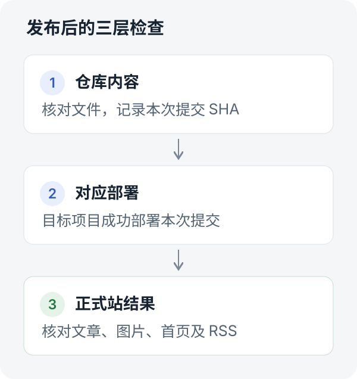

发一篇博客，看起来只需要把 Markdown 放进仓库，再提交一次。

真正操作起来，还有一些小事：文章放在哪个目录，图片怎么引用，发布日期用哪个时区，部署成功后去哪里检查。修改文章时，要确认线上已经出现新内容；删除文章时，还得看看原来的链接是否真的失效。

这些步骤单独看都不复杂，每次重新交代一遍却很烦。我的博客使用 Hugo、GitHub 和 Cloudflare Pages，我把这套发布流程整理成了一个 Agent Skill。以后说“把这篇文章发到博客”，agent 就有一份可以查阅的操作说明。

这篇文章沿着这套流程，做一个精简版的 Skill。你需要有一个已经能够正常部署的 Hugo 博客，以及一个支持 Agent Skills、具备文件操作和相应仓库访问能力的客户端。

## 一次发布需要经过哪些检查

先把任务拆开。对我的博客来说，一次发布经过下面这条路径：

```text
整理文章和图片
      ↓
检查内容并构建
      ↓
提交到目标分支
      ↓
等待对应提交部署成功
      ↓
检查正式文章页、首页和 RSS
```

这里最容易省掉的是最后一步。GitHub 上出现新文件，只能证明源文件已经提交；Cloudflare 显示构建成功，也还需要打开正式站，确认读者能看到正确的内容。



因此，我给 Skill 定的完成条件是：**找到本次提交，确认它在目标项目部署成功，再核对正式站的实际内容。**

Cloudflare Pages 的 Git 集成本来就能在推送后自动部署。Skill 要做的是准备好变更、跟踪这次部署，并检查最后的结果。[Cloudflare Git 集成文档](https://developers.cloudflare.com/pages/configuration/git-integration/)

## 先写清楚博客的固定约定

Agent Skills 的基本形式是一个目录，里面至少有一份 `SKILL.md`。文件顶部的 YAML 描述它叫什么、什么时候使用，下面的 Markdown 写具体操作。需要时，还可以附带脚本、参考资料和模板。[Agent Skills 格式规范](https://agentskills.io/specification)

先建两个文件就够了：

```text
blog-publisher/
├── SKILL.md
└── references/
    └── site.md
```

`SKILL.md` 写发布步骤，`references/site.md` 写站点约定。以后换域名、换部署项目，可以集中修改站点资料。

下面是一份可以照着填写的 `site.md`。仓库和域名使用示例值，实际使用前替换成自己的配置：

```yaml
repository: your-name/your-blog
branch: main
production_url: https://your-blog.example.com
deployment_provider: Cloudflare Pages
deployment_project: your-blog
post_path: content/post/<slug>/index.md
post_url: /p/<slug>/
build_command: hugo
build_output: public
timezone: Asia/Singapore
```

文章目录和 URL 要以自己的配置为准。我的博客使用 Stack 主题，并在 `hugo.yaml` 中把文章地址设置为 `/p/:slug/`。Hugo 的页面包可以让正文和图片放在同一个目录，文章里的图片就能用相对路径引用。[Hugo 内容组织文档](https://gohugo.io/content-management/organization/)

顺手放进去的还有文章头部模板：

```yaml
---
title: "文章标题"
date: 2026-11-12T10:00:00+08:00
draft: false
description: "一句话说明文章讲什么"
slug: example-post
categories:
  - 技术笔记
tags:
  - Agent
---
```

这里的日期只是格式示例，正式发布时使用实际时间。有封面再增加 `image` 字段；修改旧文则尽量保留原来的 slug 和发布日期，避免把已有链接改坏。

## 写出第一版 SKILL.md

下面这份是从实际流程中提炼的精简模板。配合前面的站点资料，可以作为自己博客 Skill 的起点。

````markdown
---
name: blog-publisher
description: 为 Hugo 博客准备文章、发布、修改和删除内容，并验证部署与正式站结果。用户要求操作博客文章时使用。
---

# 博客文章发布

先读取 references/site.md、当前仓库配置和适用的 AGENTS.md。
检查当前分支和工作区，只处理本次文章相关文件。

## 准备内容

按站点约定放置正文和图片，检查 front matter、链接和图片路径。
日期使用实际发布时间和站点时区。
修改旧文时保留原 slug 和发布日期，按需更新 lastmod。
用户只要求写稿或调研时交付草稿；要求发布时继续完成发布和验收。

## 构建和提交

在隔离的工作副本中构建，输出目录放在仓库外。
使用已有授权的可用渠道提交，只提交本次文章相关路径。
记录最终提交 SHA，并读回远端文件核对内容。
写入结果不明确时，先查远端状态，再决定是否重试。

## 部署和验收

按本次 SHA 和目标项目跟踪部署。
每隔 15 至 30 秒检查一次；约 10 分钟仍未结束时报告超时状态。
部署失败时读取错误，不通过空提交反复触发部署。
部署成功后打开正式文章 URL，检查标题、正文和图片。
检查首页和 RSS 是否按站点规则收录文章。
修改文章时确认新内容出现、被替换的旧内容消失。
删除文章时确认原 URL 返回 404 或 410，首页和 RSS 不再收录。
403、网络错误或带查询参数的诊断结果不能作为删除成功的证据。

## 交付

提供文章链接、提交链接、目标项目的部署状态和线上检查结果。
分别说明已完成的阶段及尚未解决的问题。
````

`description` 要写得具体，让 agent 能判断什么时候使用它。正文也尽量写成可以执行和核对的动作：读取哪个文件，提交哪些路径，看到什么结果才算完成。

这份模板不会替你配置 GitHub 或 Cloudflare 的访问权限。实际执行仍依赖客户端能使用的工具和已有授权；安装方式也以所用客户端的文档为准。

## 用一篇文章走完发布流程

把 Skill 放到客户端支持的技能目录并确认它已被发现后，可以这样提出任务：

> 把这篇文章发布到我的 Hugo 博客，slug 用 agent-publishing-demo。完成后给我文章链接、提交链接，以及部署和线上验收结果。

Agent 应该先读取站点资料，准备文章目录，再做构建检查。使用 Git 子模块安装主题的博客，还需要拉取仓库记录的主题版本。构建目录放在工作副本之外，避免把生成文件混进文章提交。

接下来提交源文件，并记录提交 SHA。等部署时，要核对这次 SHA 和目标项目；一个仓库连接了多个部署项目时，仅看见一条名为 Cloudflare Pages 的成功检查还不够。

最后检查正式站。对这次发布，至少要回答三个问题：

- 文章 URL 是否能打开，标题、正文和图片是否正确？
- 这篇文章是否出现在首页，或者站点约定的文章列表中？
- RSS 中是否已经收录这篇文章？

最后的回复应该能让人顺着链接复查。如果部署还在等待，就写“已提交，部署中”；如果页面仍是旧内容，就继续保留这个问题。

Anthropic 在 agent 评估文章中也区分了执行记录和环境里的最终结果。放到博客发布里，就是同时检查 agent 做过什么，以及网站最后变成了什么样。[Agent 评估方法](https://www.anthropic.com/research/demystifying-evals-for-ai-agents)

## 把遇到的问题写回 Skill

这套流程真正变得有用，是在跑过之后。我的发布测试里，有两个问题值得留下来。

**第一个是写入渠道的权限。** 当时 GitHub 插件能够读取仓库，创建文件却返回了 `403 Resource not accessible by integration`；本机也没有可用的 HTTPS Git 凭据。最后通过已有权限的 GitHub 网页登录会话完成了提交。

这次经历可以提炼成一条规则：每次判断当前可用的渠道。读取成功后还要核实写入能力，失败后保留错误，并检查远端是否发生变化。历史上某个渠道不可用，也不能据此断定它以后一直不可用。

**第二个是删除后的旧页面缓存。** 在 2026 年 11 月 11 日对旧站的测试中，文章源文件已经删除，首页和 RSS 也移除了记录，但不带查询参数的原 URL 仍返回旧正文。响应头中能看到 `cf-cache-status: HIT`。同一路径加上查询参数后返回了 404。

这两个访问结果不能互相替代。读者或搜索引擎保存的是原来的链接，删除验收就要检查那个地址。因此，Skill 里增加了一条明确要求：以原 URL 的实际响应为准，带查询参数的请求只用来诊断。

这次现象发生在迁移前的旧站，后来的新站在对应测试路径返回了 404。迁移到新站和清理旧站缓存，是两件分别需要验证的事。

这种异常最适合写进参考资料：记录日期、现象、尝试过的操作和验证结果。下次再遇到类似问题，agent 就有依据继续排查。

## 让 Skill 跟着流程一起维护

第一版保持简短，等重复操作多了，再把确定的检查交给脚本，例如读取文章、首页和 RSS，检查关键文本，输出结果。发布规则留在 `SKILL.md`，站点约定放在参考资料里，历史问题单独记录。

Agent Skills 的规范支持按需加载这些资源：先发现名称和描述，任务需要时读取正文，再读取相关文件。规范也建议把过长的主文件拆开，主文件保持在 500 行以内。[Skill 的渐进式加载](https://agentskills.io/specification#progressive-disclosure)

维护时尤其要留意容易过期的内容：生产分支、正式域名、部署项目和工具权限。一次成功操作可以提供经验，下一次执行仍要核对当前状态。

我现在更愿意从这类小流程开始做 Skill。步骤足够熟悉，结果也容易核对。跑通一次，就把有用的步骤留下；遇到一个问题，就补上一条能帮助下次判断的规则。

下一次发博客时，这些经验就能直接用上。
